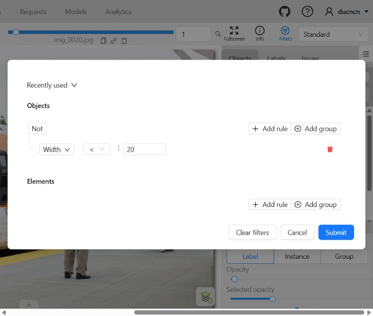
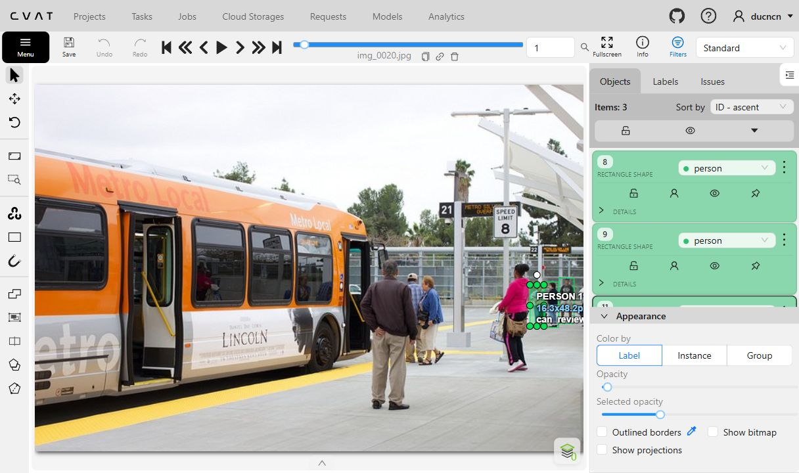

# Hai phần bonus Day09

## 1. Check mới: tỷ lệ cạnh box cực đoan (+3 theo rubric)

- Code: [`pipeline/checks/aspect_ratio.py`](../../pipeline/checks/aspect_ratio.py), giao diện chuẩn `run(ds,cfg) -> list[Issue]`.
- Tính theo pixel: `ratio=max(w*W,h*H)/min(w*W,h*H)`. Một box có w/h chuẩn hóa gần nhau vẫn có thể rất dẹt trên ảnh rộng.
- Cấu hình riêng [`configs/bonus.yaml`](../../configs/bonus.yaml): ratio>10, cạnh ngắn từ 2 px trở lên. Bỏ dòng hỏng, lớp ngoài danh mục, box không dương và ảnh không đọc được. Đây là heuristic để người kiểm, không kết luận box chắc chắn sai.
- Chỉ sinh WARN `BOX_EXTREME_ASPECT_RATIO`, không sửa dữ liệu hoặc ép gate. Dùng dispatcher chuẩn qua script riêng để không sửa registry/orchestrator/cấu hình bị bảo vệ.
- [`bonus_tests/test_aspect_ratio.py`](../../bonus_tests/test_aspect_ratio.py): **11 test**, gồm tỷ lệ pixel, biên ngưỡng, ảnh dọc/ngang, số dòng trống/hỏng, dữ liệu không hợp lệ, ngưỡng NaN/Inf, tính chỉ đọc và tính lặp lại.
- Kết quả chạy trên raw 224 ảnh và bản sau pipeline 205 ảnh: **0 box vượt 10:1**. Giữ nguyên kết quả 0, không hạ ngưỡng để tạo cảnh báo cho đẹp; test tổng hợp có ca ratio=15 để chứng minh check hoạt động.

```powershell
.\.venv\Scripts\python.exe -m pytest bonus_tests -q
.\.venv\Scripts\python.exe scripts/run_bonus_checks.py
.\.venv\Scripts\python.exe scripts/run_bonus_checks.py --src data/raw --out submission/bonus/aspect_ratio_raw
```

Kết quả: `aspect_ratio.csv|txt|json`, `aspect_ratio_raw.csv|txt|json` trong thư mục này. Khi clone mới, chạy pipeline chính trước để có work/run/ds.

## 2. CVAT lọc box nhỏ (+2 theo rubric)

[Job CVAT local](http://localhost:8081/tasks/25/jobs/24): project 3, task 25, job 24. Tạo riêng 21 ảnh từ đầu hàng đợi và thêm ảnh để có đủ 5 trường hợp lọc. Import **140 box** bằng gói **YOLO 1.1**, không chỉnh nhãn.

Bộ lọc được đặt trên giao diện: **Width < 20**. Ảnh chụp điều kiện:



| Ảnh | Frame CVAT | Items trên UI | Tính từ YOLO/pixel | BOX_TINY (cạnh ngắn<12) | Minh chứng |
|---|---:|---:|---:|---:|---|
| img_0020.jpg | 1 | 3 | 3 | 0 | [Ảnh chụp](cvat/screenshots/img_0020_filtered_items.jpg) |
| img_0053.jpg | 5 | 1 | 1 | 0 | [Ảnh chụp](cvat/screenshots/img_0053_filtered_items.jpg) |
| img_0135.jpg | 14 | 2 | 2 | 0 | [Ảnh chụp](cvat/screenshots/img_0135_filtered_items.jpg) |
| img_0030.jpg | 2 | 3 | 3 | 0 | [Ảnh chụp](cvat/screenshots/img_0030_filtered_items.jpg) |
| img_0124.jpg | 11 | 1 | 1 | 0 | [Ảnh chụp](cvat/screenshots/img_0124_filtered_items.jpg) |



**Đối chiếu:** tổng cộng 10 box khớp, 5/5 số đếm UI đúng bảng đo. Cả 10 box có cạnh ngắn ≥12 px nên pipeline không cờ BOX_TINY. `width<20` khác `min(width,height)<12`, vì vậy hai tập không bắt buộc giống nhau. Lọc không đồng nghĩa phải xóa; không xóa box chỉ vì nhỏ.

**can_review:** thuộc tính đánh dấu ca khó/chưa chắc để người kiểm lại; trong pipeline, vai trò tương tự các WARN được chuyển vào review_queue. Nó không tự sửa nhãn hay làm biến mất lỗi bắt buộc. Tất cả box trong task vẫn giữ giá trị mặc định false; không giả vờ đã duyệt ngữ nghĩa 140 box.

Bằng chứng: [`observed_filters.csv`](cvat/observed_filters.csv) là số đếm đã đọc trên UI; [`expected_filters.csv`](cvat/expected_filters.csv) và [`box_measurements.csv`](cvat/box_measurements.csv) là phép đo trên nhãn nguồn; [`verification.json`](cvat/verification.json) ghi task/job và đối chiếu. Ảnh COCO và giấy phép tham chiếu [`data/ATTRIBUTION.csv`](../../data/ATTRIBUTION.csv).

## Tái lập task

```powershell
.\.venv\Scripts\python.exe scripts/prepare_bonus_cvat.py
```

Lệnh tạo `work/bonus/cvat/images`, `annotations_yolo11.zip`, `selection.json`, `labels_compatible.json`. Tạo task CVAT từ ảnh và import YOLO 1.1. Bản labels tương thích chỉ điền values=["false"] cho checkbox vì CVAT hiện tại yêu cầu; giữ nguyên `cvat/labels.json` của đề.

## Phạm vi và kiến thức rút ra

- Bài chính giữ nguyên config, manifest, verdict Hold và bốn JSON kết quả train; không chạy lại dataset/export để làm biến đổi thí nghiệm đã đo.
- Học được: đo box bằng pixel thay vì tỷ lệ chuẩn hóa; kiểm thêm cần ngưỡng giải thích được và test biên; so sánh bộ lọc phải thống nhất tiêu chí; một phép kiểm mới có thể hợp lệ dù không phát hiện vấn đề trong lô hiện tại.
- Bằng chứng cho hai hạng mục thưởng đã chuẩn bị; điểm thưởng thực tế do giảng viên chấm, tổng điểm không vượt 100.
